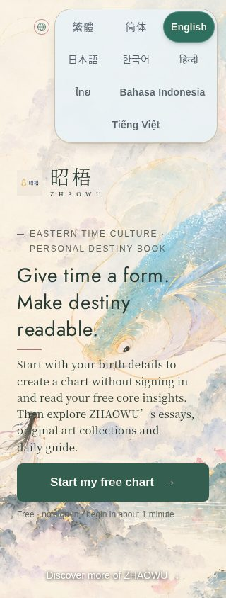
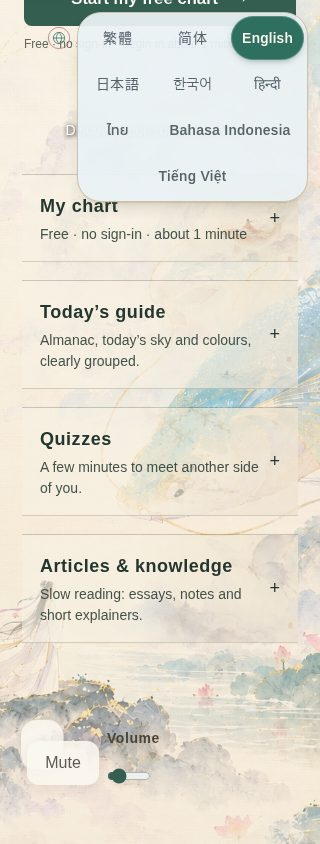
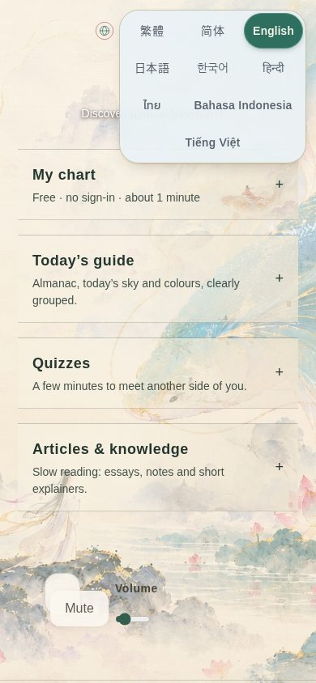
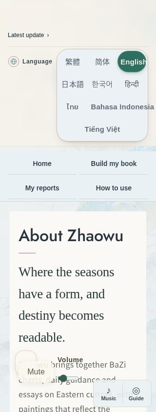
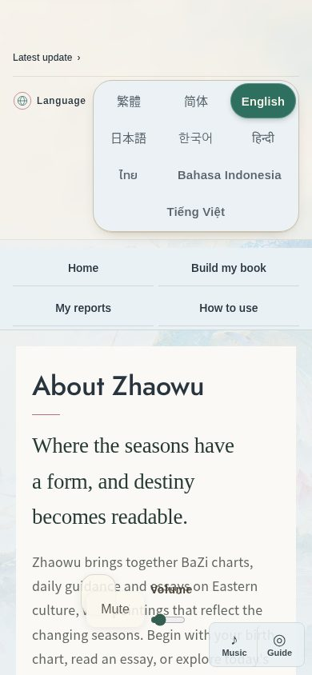

The homepage language switcher scrolled out of view and explicit Japanese/Korean/Hindi choices were reset. Keep it fixed in the top-right safe area, restore those choices, and add Thai, Indonesian and Vietnamese UI dictionaries loaded only when selected.

All changes continue the existing `fix/homepage-fixed-lang-switcher` WIP. **PR only: do not merge or deploy.** No changes to vercel.json, Supabase connections, calculation, auth, payment or ranking engines. No new service or infrastructure cost.

- Nine native-script options with 44px targets; narrow phones use a four-row grid with extra space for Bahasa Indonesia. Inner-page switcher remains present.
- Each new pack covers the same 177 UI keys as JA/KO/HI (the additional current CopyKey `errDate` retains fallback). Article/report bodies retain existing Chinese/English fallback. All non-Chinese calculation locales remain `en`.
- Dynamic imports are inside the language application path, with in-flight request deduplication, dictionary caching, retry after import failure, and a guard against a slow previous choice replacing the latest language.

Validation:

- `npm run build`: PASS, including prebuild, Vite, route HTML generation and TypeScript. Generated build-only public assets and route tree changes are excluded from this PR.
- `node --test scripts/display-language-r102.test.mjs scripts/home-tree.test.mjs`: 8/8 PASS.
- `node scripts/display-language-preview.mjs` against local production-build preview: PASS at 320px and 390px. Checks initial fixed position, scrolling to all four homepage blocks, nine unclipped 44px targets, JA/KO/HI/TH/ID/VI persistence after reload, English engine locale, inner-page selector, delayed import race and cached repeat selection.
- Additional legacy diagnostic `scripts/home-sheet-ui-v5.test.mjs`: 1 pass / 2 failures because `src/parchment-layout.css` and `src/legacy-visual-compat.css` are already absent in main. Those unrelated tests were not changed.
- `git diff --check`: PASS.

Dynamic-import evidence from the built output:

| Language | Separate chunk | Bytes |
|---|---|---:|
| Thai | `th-n8Rj7YRM.js` | 17,883 |
| Indonesian | `id-QJ8_QsNJ.js` | 9,166 |
| Vietnamese | `vi-DBLSLc1u.js` | 10,256 |

Each dictionary's unique copy occurs only in its own chunk, never in the main entry or another chunk. None is preloaded in dist/index.html. Browser network capture requests none for an English visitor; each module is requested upon selection. A delayed Thai import cannot replace a subsequent English selection, and selecting Thai again requests no second module in that session. See committed `chunks.json` and `verification.json`.

Screenshots captured directly from local preview (not production):

Patched strings (only requested JA/KO/HI dictionary keys):

JA:
- `chong`: 「沖」
- `sha`: 「煞の方位」

KO:
- `faq1a`: 「昭梧는 전통 자평 사주를 유일한 핵심 판단으로 사용합니다. 전생／육도 질문은 달마일장경(達摩一掌經)의 확정식 계산만 사용하며 추가 AI 추측은 하지 않습니다.」
- `proofPrimaryTitle`: 「자평을 핵심 판단으로」
- `wuxing`: 「왕쇠의 기초」
- `strength`: 「왕쇠의 기초」

HI:
- `sha`: 「अशुभ दिशा」
- `dayMaster`: 「जन्म-दिन का स्वामी (दिन का आकाशीय तना)」
- `nayin`: 「ध्वनि से संबद्ध पंचतत्व (ना यिन)」
- `shishen`: 「दस संबंध-प्रतीक (दस देवता)」
- `xunkong`: 「दस-दिवसीय चक्र की रिक्त शाखाएँ (शुन कोंग)」
- `zi`: 「मध्यरात्रि के दो घंटे (ज़ि काल) में तिथि बदलने का नियम」
- `faq1a`: 「昭梧 में पारंपरिक ज़िपिंग आठ-अक्षर पद्धति ही मुख्य निर्णय का आधार है। पूर्वजन्म और छह लोकों के प्रश्नों के लिए बोधिधर्म की एक-हथेली सूत्र पद्धति (達摩一掌經) से निश्चित नियमों पर आधारित जन्म-चक्र बनाया जाता है; AI की अटकलें नहीं जोड़ी जातीं।」
- `proofBoundaryBody`: 「ज़िवेई, पाश्चात्य ज्योतिष, छह रेखाओं की दिव्य-प्रश्न पद्धति और अन्य प्रणालियाँ अपनी स्वतंत्र गणना जुड़ने तक ‘अभी जुड़ी नहीं’ के रूप में दिखाई जाएँगी।」

Production preflight only: current main/live runtime `be578a354bb2036f6e310a82916f7e5be19816b5`, existing production READY deployment `dpl_AjPGYwvMq2dY19NQDeUmgouoLtvX`. No production or preview deployment was created. Rollback after any future approved merge is a source revert; no data or schema changes.
