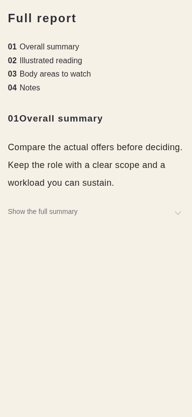
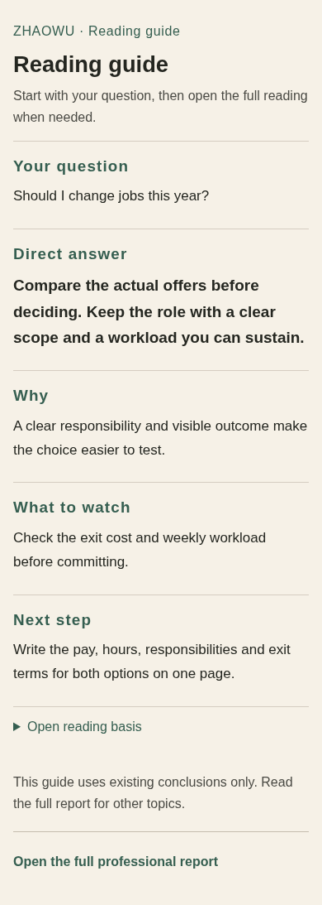

# P1 390px comparison

These screenshots use an anonymous fixture and the actual report CSS. The after frame renders the new React guide; the before frame mirrors the prior report header, navigation and summary markup. They are local review evidence, not Production captures.

