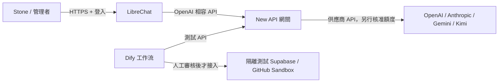

# 昭梧 AI Hub：架構與審核方案

> **狀態：提案／設定樣板，尚未部署。** 本目錄不授權採購、建立雲端資源、連接正式服務或合併。預設目標是 A$0/月；任何付費主機、模型額度、託管服務或超額費用都須 Stone 對具體項目與金額明確批准。所有功能先在獨立測試環境驗證。

## 目標與邊界

- 將 OpenAI、Anthropic、Gemini、Kimi 等供應商接到單一 OpenAI 相容 API 網關，讓客戶端集中設定一個測試端點。
- 用 LibreChat 做手機友善的對話介面，集中保存對話、以 `@` 選模型並做多模型比較。實際 UX 與版本能力須在測試環境驗證。
- 用 Dify 編排內容生成、邏輯審查、格式化，最後輸出 JSON；此範例不會寫入 Supabase 或建立 GitHub 任務，避免把提案誤當成已授權的寫入流程。
- GitHub、Vercel、Supabase 僅提供測試環境接法。不得使用昭梧 Production（`zhao-wu.com`、Vercel `stone-zhaowu-official`、正式 Supabase 專案或其金鑰）。

## 架構



本機 Compose 只提供一台主機上的網關與 LibreChat 骨架；Dify 以官方自架套件獨立部署，因其依賴服務較多，不把龐大且版本易變的依賴清單複製進這份方案。Dify 若未部署，Compose 仍可驗證設定語法。所有服務應放在 VPN 或受控反向代理後，不可直接公開管理介面。

LibreChat 與網關分別使用管理憑證及一般使用者 token；`AI_GATEWAY_ADMIN_TOKEN` 只供網關管理者操作，不提供給對話 UI。實際網關版本/環境變數、初始化管理員流程與使用者 token 發行方式須依選定版本官方文件重新核對後設定。本 Compose 為提案骨架，僅驗證 YAML/Compose 結構，不代表服務已可直接啟動。

## 元件選型

| 項目 | 選項 | 優點 | 代價／風險 | 建議 |
|---|---|---|---|---|
| API 網關 | One-API | OpenAI 相容；介面簡單；部署資源需求較低 | 原始專案維護狀態、供應商相容性與安全修補須在採用前查核；衍生版分歧 | 不直接採用未確認維護狀態的舊版；若評估，先做唯讀安全與授權審查 |
| API 網關 | New API | One-API 衍生路線；常見多供應商渠道、金鑰與用量管理 | 仍是第三方閘道，需自行更新、備份及保護管理面；不能視為供應商官方產品 | **建議先以 New API 做隔離 PoC**，確認目前維護、版本、授權、渠道與用量限制後再決定 |
| 對話介面 | LibreChat | 多供應商/自訂 OpenAI 相容端點；多模型對話能力；使用者與歷史管理 | 需資料庫及設定管理；手機窄螢幕、模型標記及比較 UX 須實機驗收 | **建議**，因本需求同時重視多模型與集中歷史；先以 iPhone 窄螢幕驗收 |
| 對話介面 | Open WebUI | 自架及 OpenAI 相容端點整合；單機試用容易 | 部分功能常以 Ollama 為主要路徑；多雲端模型比較、帳號隔離及手機工作流需驗證 | 若偏好本機模型或最簡單自架，可作備選 PoC |

選型是待審方案，不代表已完成對上游安全、授權或目前版本的調查；採用前需核對官方文件、版本與授權。

## 主機與費用估算

金額是未即時詢價的容量規劃區間（AUD/月），不是任何供應商報價；不含 GST、域名、備份異地副本、供應商模型 token、流量超額或管理工時。供應商與地區價格會變動，採用前須重新取得當前報價。**不可據此自動採購。**

| 路線 | 建議資源 | 主機/託管估算 | 模型 API | 備註 |
|---|---|---:|---:|---|
| 本機／家用測試 | 4 核 CPU、8 GB RAM、30 GB SSD（LibreChat + 網關）；另給 Dify 至少 4 核、8 GB RAM、50 GB SSD | A$0 增量（已有設備/電力網路成本不計） | 按供應商計費；使用前須核准上限 | 只適合單人 PoC；Dify 與資料庫同機時建議 16 GB RAM；做好加密備份 |
| 單台 VPS 測試 | 4 vCPU、16 GB RAM、100 GB SSD；另行評估備份 | 約 A$30–100/月 | 另計 | 需 Stone 先批准主機費及流量/備份費；不要用正式網站主機 |
| 託管應用/資料庫 | 依服務商最小方案，隔離帳號與專案 | 約 A$20–150+/月 | 另計 | 免費額度可能休眠、限流或有資料保留限制；不應存正式資料 |
| 免費自架軟體 | LibreChat、New API、Dify 可自行部署；軟體授權/自架方式依各上游版本確認 | A$0 軟體費 | 另計 | 主機、電力、備份、管理時間不一定為零；免費模型額度亦不保證持續提供 |
| 雲端模型 | 不適用 | A$0 固定費未必可行 | 使用量計費，依模型與 token 變動，無可靠固定估價 | 設置硬上限/告警前不得接入；上限本身仍需 Stone 明確核准 |

**預算決策：**目前建議只做本機 Compose 語法驗證與本機隔離 PoC。任何雲端主機、付費 Dify/LibreChat 託管、模型 API 點數或網域新增，均須 Stone 明確批准服務、月上限及付款方式後才可採購；免費方案仍要先核對商用條款、休眠/刪除政策與資料所在地。

## 部署步驟（未執行）

1. Stone 審核本方案，決定採用 New API/LibreChat 或替代元件、主機位置、資料保留期與預算上限。
2. 建立與昭梧完全隔離的測試主機/帳號；確認沒有 Production DNS、Vercel、Supabase 或 GitHub 權限/憑證。
3. 複製 `.env.example` 為本機 `.env`，由管理者透過安全管道填測試用密碼與供應商金鑰；不得提交 `.env`、截圖或日誌中的秘密。
4. 先執行 `docker compose config` 檢查設定，再由操作者另行決定是否啟動；第一次只用假資料及可撤銷的測試金鑰。
5. 獨立依 Dify 官方自架文件部署 Dify 到測試環境，匯入 `dify/content-review.yml`，先以假輸入測試，檢查輸出與敏感資料處理。
6. 在 iPhone Safari 窄螢幕驗收登入、模型切換、多模型比較、歷史搜尋/刪除、登出與 session 到期；記錄版本和結果。
7. 完成安全、成本與備份審查後另立變更/任務單；任何正式整合必須再經獨立測試與 Stone 明確批准。

### 測試環境整合方式（說明，未接通）

- **API 網關 → Dify/LibreChat：**各自設定為 `http://ai-gateway:3000/v1`（Compose 內部）或受控測試域名的 OpenAI 相容 API Base URL。供應商模型 ID、API Key 和使用者 token 由測試管理者設定；UI 不應暴露供應商主金鑰。
- **Dify → Supabase 測試庫：**未在範例工作流中加入寫入節點。若後續需要，新增隔離測試專案、最小權限 RPC/Edge Function 與測試資料表，Dify 僅呼叫測試域名、使用可輪替的測試憑證；先以 dry-run 輸出 SQL/JSON，人工審核後才啟用寫入。不得填入正式專案 URL、service role key 或正式資料。
- **Dify → GitHub 任務單：**未在工作流中配置 GitHub 寫入。若核准，使用只限測試 repository、只允許建立 issue 的細權限 GitHub App/Token；先輸出草稿供人工確認，不給 org 管理或正式 repo 權限。
- **Dify → Vercel：**只可呼叫隔離測試專案的預覽/測試 API 或部署 hook；避免在本倉庫分支觸發正式 Vercel Preview/Production。此方案不含任何 hook URL/token。

## 安全與運維注意

- `.env` 僅存本機或秘密管理器，檔案權限限制為擁有者可讀；使用 `.env.example` 佔位符，不將真值貼到 Issue/PR/日誌。
- 網關管理者密碼、LibreChat session secret、資料庫密碼與供應商金鑰必須各自不同、可撤銷、定期輪替；金鑰不得給瀏覽器端或一般對話使用者。
- 綁定到 loopback 或私有網路，前置 TLS、MFA/SSO（若支援）、速率限制與 IP/VPN 控制；停用未使用的管理入口。
- 預設最少保留對話資料；確認資料存放地、備份加密、刪除策略與日誌遮罩。供應商資料訓練/留存設定逐家確認。
- 限制容器權限、固定映像版本與 digest 後再上線；定期更新並先在測試環境掃描。樣板中的 `latest` 僅供本機設定驗證，正式採用前必須固定已審核版本。
- 提供者 API 是可計費資源；為每個測試帳號設置最低限額與告警。未設定花費上限前不要提供外部使用者存取。

## 回滾方式

1. 停止並移除測試 Compose 容器：`docker compose down`；需要清除測試資料時先確認備份，再由操作者明確指定資料卷，避免誤刪。
2. 將測試 DNS/反向代理路由切回原測試頁或停用，不修改任何昭梧 Production 路由。
3. 在供應商控制台撤銷測試 API Key、GitHub 測試憑證與 webhook secret；停用測試整合。
4. 若只是設定錯誤，回復該 PR 的設定檔版本；不需要也不應對正式環境做回滾操作。
5. 保留必要稽核紀錄，清除測試對話與備份時依已批准的保留政策處理。

## 本地語法驗證

在本目錄執行（`docker compose` 需已安裝；本次工作環境未安裝 Docker CLI，因此尚未完成此項驗證）：

```sh
docker compose --env-file .env.example config
```

此命令只解析/渲染設定，不會拉取映像、啟動服務、連接網路或寫入雲端資源。
